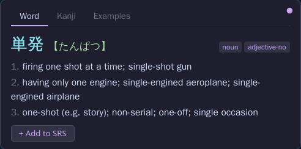
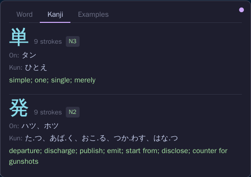
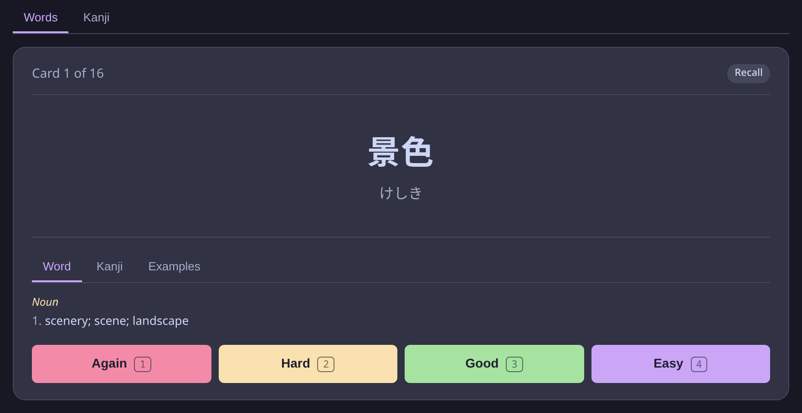
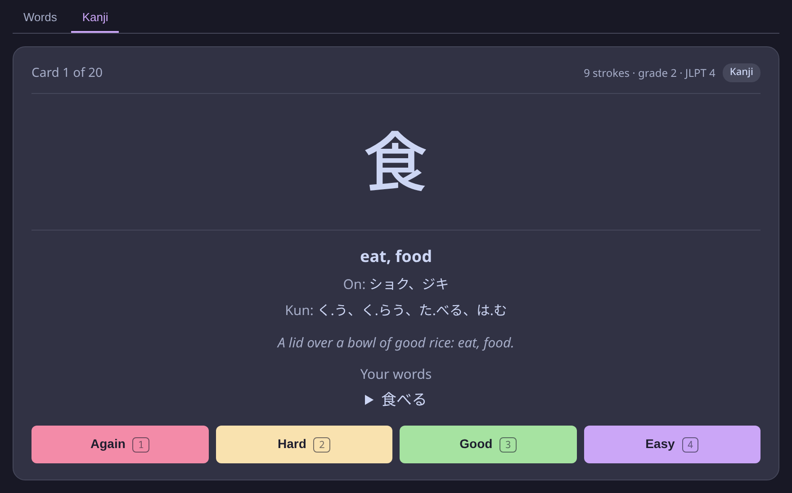
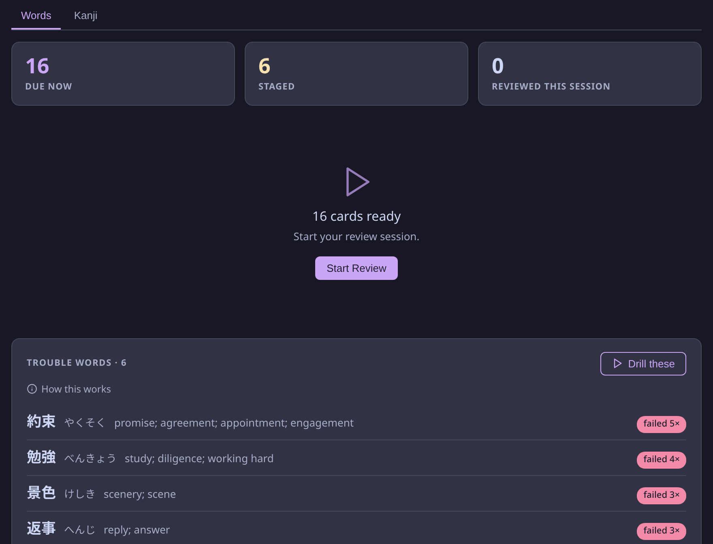
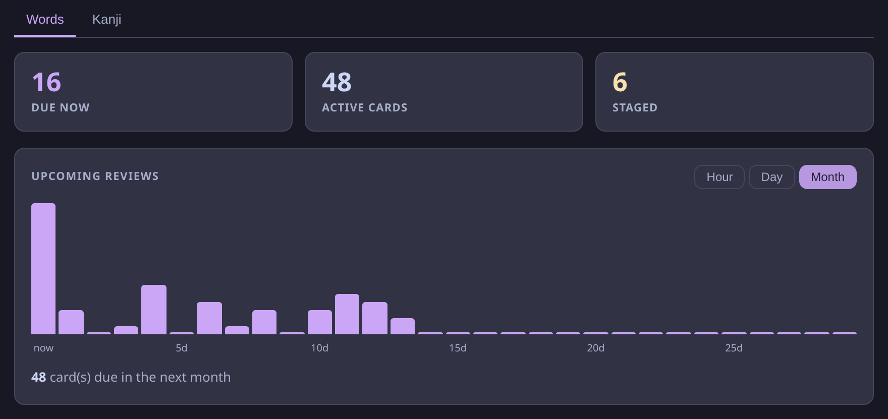
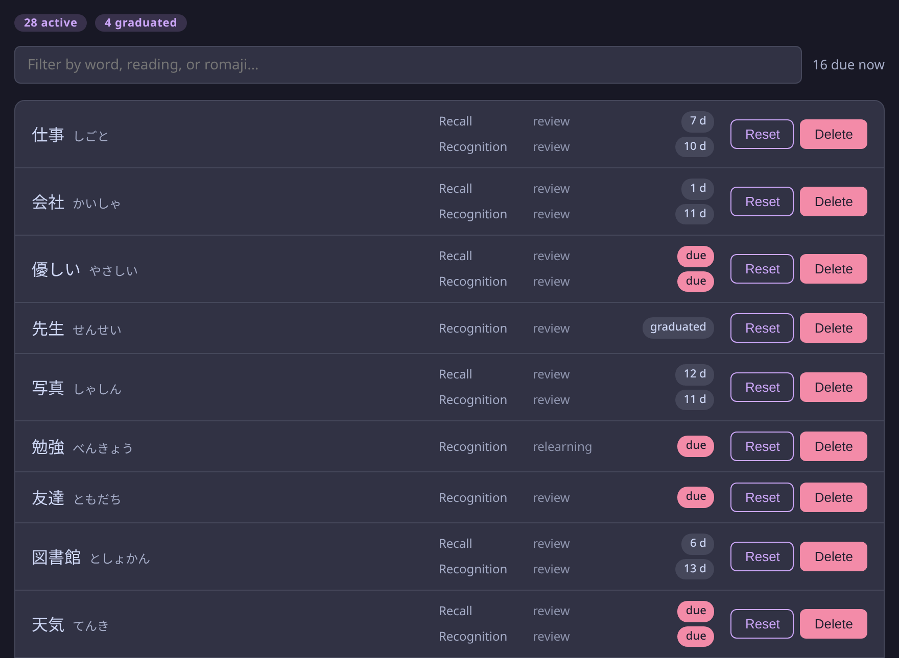
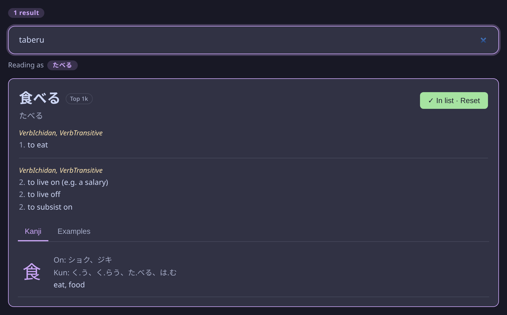

# Yomeru


> **Experimental project.** This is a work in progress and not production-ready. A significant portion of the code was written with AI assistance (Claude). Use at your own risk and expect rough edges.

Yomeru is an on-hover Japanese dictionary with spaced-repetition (SRS) vocabulary and kanji review. It comes in three forms:

- **Firefox extension.** Hover over Japanese text on any page to see the reading, part of speech, and English definitions, then add the word to your deck.
- **Web app.** The same review, word list and lookup screens as a website, backed by `yomeru-server`.
- **Android app.** The same app with the dictionaries bundled, so lookup works offline.

An optional account (email + one-time code) syncs your deck between all three.

Built with as much Rust as possible. Dictionary lookup, deinflection and scheduling are Rust crates, compiled to WebAssembly for the extension. The extension's options page and the web/Android apps are written in [Dioxus](https://dioxuslabs.com/). The hover popup is a small Svelte component, and the rest of the JavaScript is a thin WebExtensions bridge.

## Features

**Lookup**
- Hover any Japanese text → popup with reading, POS tags, glosses and word frequency
- Longest-match algorithm: hovering over a conjugated form like 食べられなかった finds 食べる
- Deinflection covers ichidan, godan (all 9 types), i-adjectives, する, 来る
- A highlight shows exactly which characters were matched
- Kanji tab: on/kun readings, stroke count, JLPT level, meanings, and the kanji's parts (from KanjiVG) with a mnemonic phrase
- Examples tab: example sentences, simplest first
- Select Japanese text → exact dictionary lookup
- Lookup screen with romaji input, homophones and search history

**Review**
- [FSRS](https://github.com/open-spaced-repetition/fsrs-rs) scheduling, with word → meaning and meaning → word cards
- Kanji review tab, plus drills for words and kanji you keep failing
- Session recaps, a stats page with an upcoming-reviews forecast, keyboard shortcuts for answering
- New Words staging with priorities, and a searchable word list
- JSON export/import of your deck

**Sync**
- Email + OTP login, delta sync between the extension, web app and Android app

## Screenshots

### Hover popup (extension)

<table>
  <tr>
    <td></td>
    <td></td>
    <td></td>
  </tr>
  <tr>
    <td align="center">Word</td>
    <td align="center">Kanji</td>
    <td align="center">Examples</td>
  </tr>
</table>

### App (web / Android / extension options page)

<table>
  <tr>
    <td></td>
    <td></td>
  </tr>
  <tr>
    <td align="center">Word review</td>
    <td align="center">Kanji review, with its mnemonic</td>
  </tr>
  <tr>
    <td></td>
    <td></td>
  </tr>
  <tr>
    <td align="center">Trouble words to drill</td>
    <td align="center">Upcoming-reviews forecast</td>
  </tr>
  <tr>
    <td></td>
    <td></td>
  </tr>
  <tr>
    <td align="center">Word list</td>
    <td align="center">Lookup (romaji input)</td>
  </tr>
</table>

## Install

From the [Releases page](https://github.com/F4r3n/Yomeru/releases):

- **Firefox (143+):** download the signed `.xpi`, then open **about:addons** → gear icon → **Install Add-on From File**. It updates itself from later releases.
- **Android:** download the `.apk` and install it (allow installs from unknown sources when asked).

## Repository layout

| Path | What's there |
|---|---|
| `crates/` | Core Rust crates: `japanese-utils`, `deinflect`, `jmdict-*`, `kanjidic-*`, `examples-*`, `srs-*`. Each `-core` crate holds the logic, its `-wasm` crate exposes it to JavaScript, and `-build` crates turn the source data into binary indexes |
| `extension/` | Firefox extension: manifest, TypeScript background script and Svelte/TypeScript content script (hover popup) |
| `app/shared/` | Dioxus UI, storage, sync and dictionary glue shared by every client |
| `app/extension/` | Extension toolbar popup / options page (Dioxus) |
| `app/web/` | Web app entry point (`yomeru-web`) |
| `app/android/` | Android app entry point (`yomeru-android`) |
| `server/` | `yomeru-server`: Axum + SQLite service for login, sync and dictionary lookup over HTTP |
| `data/` | Hand-written kanji mnemonic phrases and plain part names, laid over KANJIDIC |
| `xtask/` | Build tasks (`cargo xtask …`) |

More detail: [`app/README.md`](app/README.md), [`server/README.md`](server/README.md), [`DEPLOY.md`](DEPLOY.md).

## Prerequisites (building from source)

- Firefox 143+
- Rust toolchain with the `wasm32-unknown-unknown` target: `rustup target add wasm32-unknown-unknown`
- [`wasm-pack`](https://rustwasm.github.io/wasm-pack/): `cargo install wasm-pack`
- Node.js + npm (for the extension's TypeScript/Svelte build)
- [Dioxus CLI](https://dioxuslabs.com/) for the web and Android apps: `cargo install dioxus-cli`
- Android SDK + NDK and `cargo-ndk` for the Android app (or Podman, see `app/android/podman-build.sh`)

## Build

```bash
# Full build: download JMdict, KANJIDIC2, KanjiVG and examples (if missing)
# → build binary indexes → compile WASM → build JS
cargo xtask build-all

# Rebuild WASM only (fast iteration)
cargo xtask build --profile dev

# Build only the three dictionary indexes (jmdict.bin, kanjidic.bin, examples.bin)
cargo xtask build-dicts

# Rebuild one index from an existing source file
cargo xtask build-dict --input JMdict_e

# Package the extension into release/
cargo xtask package

# Run tests (host crates only; WASM crates require wasm-pack)
cargo xtask test
```

Web and Android apps:

```bash
cd app/web && dx serve                          # web dev server (needs yomeru-server running)
cd app/android && dx serve --platform android   # run on a device or emulator
```

## Load in Firefox

1. Open `about:debugging#/runtime/this-firefox`
2. Click **Load Temporary Add-on**
3. Select `extension/manifest.json`

## Dictionary data

Word entries come from [JMdict](https://www.edrdg.org/jmdict/j_jmdict.html), kanji details from [KANJIDIC2](https://www.edrdg.org/kanjidic/kanjidic_doc.html), and example sentences from the EDRDG examples file (Tatoeba), all from the Electronic Dictionary Research and Development Group. Kanji parts come from [KanjiVG](https://kanjivg.tagaini.net/). Each source is compiled into a compact binary index: an FST for fast key lookup plus postcard-encoded entries.

**Data flow (extension):** `mousemove` (debounced 60 ms) → `extract_japanese_run(text, offset)` → `Dictionary.lookup_at(run)` (longest-match + deinflection via FST) → shadow DOM popup + CSS highlight → "+ Add to SRS" → background script → IndexedDB → sync to `yomeru-server` when signed in.
